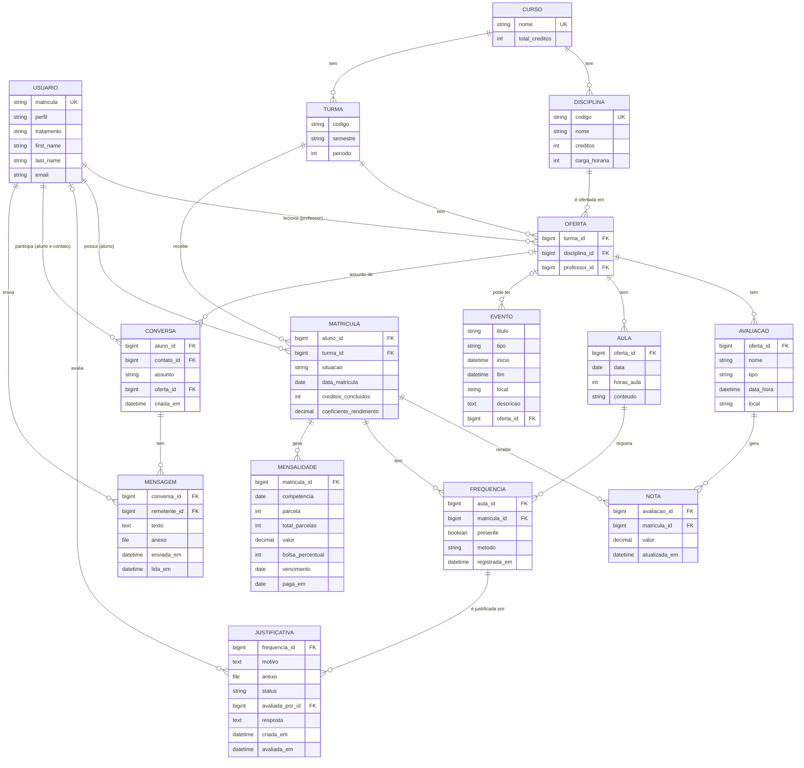

# Diagrama de entidades (DER)

Modelos dos apps `academico`, `mensagens` e `financeiro` e sua ligação com o usuário do sistema (`contas.Usuario`).

## Decisões de modelagem

- **Oferta** é uma disciplina em uma turma, com o seu professor. O professor só acessa as ofertas ligadas a ele.
- **Matricula** liga o aluno à turma, e o aluno cursa todas as disciplinas ofertadas nela.
- **Aula** representa uma chamada. **Frequencia** é o log de presença de cada aluno nessa aula.
- **Justificativa** aponta para uma falta real. Mesmo aprovada, ela não altera a frequência.
- **Avaliacao** aparece direto no calendário. **Evento** guarda as demais datas, e um evento sem oferta é institucional.
- **Histórico simplificado:** os semestres anteriores não são cadastrados. Os créditos concluídos e o coeficiente de rendimento ficam na `Matricula`.

- **Conversa** liga um aluno a um contato: um professor ou um coordenador, que aparece como "Secretaria acadêmica". Mensagem não lida é a que tem `lida_em` vazio.
- **Mensalidade** é um módulo extra e simulado: o sistema não gera boleto nem processa pagamento. A situação (Pago, A vencer ou Em atraso) é calculada a partir das datas.

## Valores calculados

Média, frequência e selo de situação não são salvos no banco. Eles são calculados em `apps/academico/calculos.py`.

| Valor | Regra |
|---|---|
| Média | Média simples das avaliações lançadas |
| Frequência | Horas presentes ÷ horas de aula dadas |
| Selo "Em risco" | Frequência abaixo de 75% ou média abaixo de 6 |
| Selo "Em atenção" | Frequência abaixo de 80% ou média abaixo de 7 |
| Selo "Regular" | Todos os outros casos |
